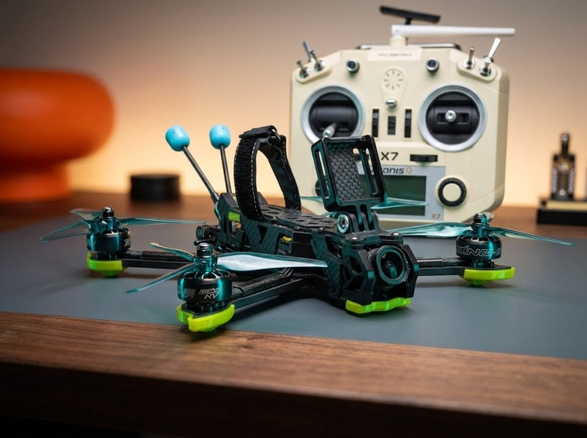
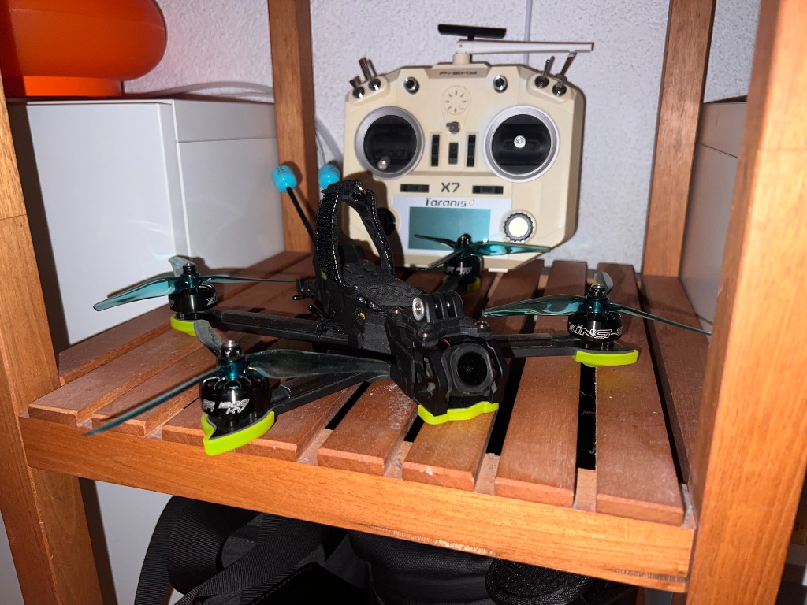
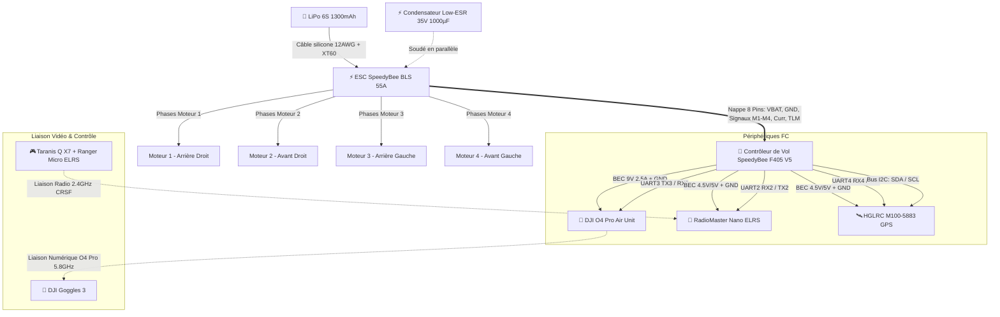
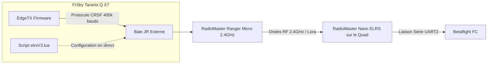
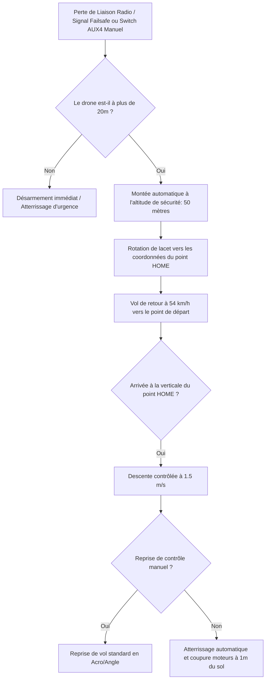

# 🛸 Drone FPV 5" Freestyle & Cinématique HD (6S)
### Conception, Assemblage Matériel, Câblage et Configuration Logicielle Intégrale


---

## 📸 Présentation du Build

Ce projet documente la conception complète, l'assemblage électronique/mécanique et le paramétrage logiciel d'un drone FPV 5 pouces haut de gamme. Conçu autour d'une géométrie **Deadcat** pour éliminer les hélices du champ de vision de la caméra, ce quadricoptère est optimisé à la fois pour le **freestyle incisif** et la **prise de vue cinématique 4K**.

| Vue Principale du Nazgul DC5 & Taranis Q X7 | Setup Complet sur Étagère |
| :---: | :---: |
|  |  |
| *Le Nazgul DC5 V1.1 O4 Pro assemblé avec ses protections TPU vert lime, caméra DJI O4 Pro et la Taranis Q X7 modifiée ELRS.* | *Intégration compacte sur banc avec antennes double polarisation et système de secours GPS.* |

---

## 📑 Sommaire

1. [Fiche Technique des Composants](#-fiche-technique-des-composants)
2. [Architecture Matérielle & Schéma de Câblage](#-architecture-matérielle--schéma-de-câblage)
3. [Flash & Configuration de la Radiocommande (EdgeTX & ExpressLRS)](#-flash--configuration-de-la-radiocommande-edgetx--expresslrs)
4. [Configuration Complète sous Betaflight 4.5](#-configuration-complète-sous-betaflight-45)
5. [Système de Sécurité GPS Rescue (RTH Autonome)](#-système-de-sécurité-gps-rescue-rth-autonome)
6. [Checklist Pré-Vol & Procédure de Validation](#-checklist-pré-vol--procédure-de-validation)
7. [Résolution des Pannes (Troubleshooting)](#-résolution-des-pannes-troubleshooting)
8. [Perspectives & Évolutions Futures](#-perspectives--évolutions-futures)

---

## 🛠 Fiche Technique des Composants

| Rôle | Composant | Spécificités & Rôle Technique |
| :--- | :--- | :--- |
| **Châssis** | **iFlight Nazgul DC5 V1.1 O4 Pro** | Géométrie **Deadcat** (bras avant reculés, aucune hélice dans l'enregistrement 4K). Carbone 3K haute rigidité, bras de 5 mm chanfreinés. |
| **Contrôleur de Vol (FC)** | **SpeedyBee F405 V5** | MCU STM32F405, Gyroscope ICM42688P filtré, Baromètre DPS310 intégré, module Bluetooth/Wi-Fi BLE pour configuration sur smartphone via l'application SpeedyBee. |
| **Variateur (ESC)** | **SpeedyBee BLS 55A 4-en-1** | 55A continus (pics à 65A), firmware Bluejay pour filtrage RPM bidirectionnel (DShot300/600), diode de protection TVS intégrée. |
| **Moteurs** | **iFlight XING-E Pro / XING 2207 1800KV** | Moteurs brushless coupleux spécialement bobinés pour la tension 6S (25.2V max). Arbre creux en acier/titane, roulements haute vitesse NSK. |
| **Hélices** | **Tripales 5 pouces (5140 / 51433)** | Accroche agressive en virage, réponse instantanée sans flottement (*propwash*) en sortie de plongeon. |
| **Alimentation** | **LiPo 6S 1300mAh (120C–150C)** | Décharge instantanée élevée (>150A) pour absorber les appels de courant pleins gaz sans affaissement de tension (*voltage sag*). |
| **Filtrage Électrique** | **Condensateur Low-ESR 35V 1000µF** | Élimination des bruits électriques et des pointes de surtension induites par le freinage régénératif des moteurs. |
| **Système Vidéo HD** | **DJI O4 Pro Air Unit + DJI Goggles 3** | Transmission numérique Full HD / 4K 60/120 fps à ultra basse latence (< 20 ms). Débit jusqu'à 60 Mbps pour repérer instantanément branches et fils électriques. |
| **Récepteur Radio (RX)** | **RadioMaster Nano ELRS 2.4GHz** | Protocole ExpressLRS ultra réactif (taux de rafraîchissement jusqu'à 500Hz/1000Hz), antenne T-dipole à l'arrière. |
| **Radiocommande (TX)** | **FrSky Taranis Q X7 + Ranger Micro ELRS** | Radio flashée sous **EdgeTX**, équipée du module externe **RadioMaster Ranger Micro 2.4GHz** (puissance dynamique jusqu'à 1000 mW). |
| **GPS & Boussole** | **HGLRC M100-5883 M10** | Puce GPS/Galileo/Glonass de 10ᵉ génération (fix rapide de 15+ satellites) couplée à un magnétomètre QMC5883L pour le mode GPS Rescue. |
| **Pièces TPU 3D** | **Supports & Protections Vert Lime** | Bumpers de protection moteur, patins d'atterrissage, support d'antennes O4/ELRS et support incliné caméra d'action avec amortisseurs anti-vibrations (*anti-jello*). |

---

## 🔌 Architecture Matérielle & Schéma de Câblage

### Diagramme d'Interconnexion Système



---

### Schéma Détaillé des Connexions (Pinout SpeedyBee F405 V5)

> [!IMPORTANT]
> **Règle absolue des liaisons série (UART) :** Le **TX** (Transmission) d'un équipement doit **toujours** être relié au **RX** (Réception) de la carte de vol, et inversement (**RX vers TX**).

```text
========================================================================================
                      SCHÉMA DE CÂBLAGE : SPEEDYBEE F405 V5 STACK
========================================================================================

    [ ESC SPEEDYBEE 55A 4-IN-1 ]
    +---------------------------------------------------------------------------------+
    |  [M4: Av. Gauche]                                            [M2: Av. Droit]    |
    |   o  o  o                                                     o  o  o           |
    |                                                                                 |
    |   [+]  PAD BATTERIE ROUGE  <==== [Condensateur 35V 1000µF] ====> XT60 (+)       |
    |   [-]  PAD BATTERIE NOIR   <===================================> XT60 (-)       |
    |                                                                                 |
    |   [M3: Arr. Gauche]                                          [M1: Arr. Droit]   |
    |   o  o  o                                                     o  o  o           |
    +---------------------------------------------------------------------------------+
                                         || (Nappe 8 fils)
                                         \/
    [ FLIGHT CONTROLLER SPEEDYBEE F405 V5 ]
    +---------------------------------------------------------------------------------+
    |                                                                                 |
    |  [UART2 - RÉCEPTEUR ELRS]           [UART3 / BEC 9V - DJI O4 PRO AIR UNIT]     |
    |    - 4.5V / 5V  <--- Fil Rouge (VCC)    - 9V (BEC VTX) <--- Fil Rouge (Power)   |
    |    - GND        <--- Fil Noir  (GND)    - GND          <--- Fil Noir  (GND)     |
    |    - R2 (RX2)   <--- Fil Jaune (TX)     - R3 (RX3)     <--- Fil Blanc (TX VTX)  |
    |    - T2 (TX2)   <--- Fil Blanc (RX)     - T3 (TX3)     <--- Fil Gris  (RX VTX)  |
    |                                                                                 |
    |  [UART4 & I2C - GPS & BOUSSOLE HGLRC M100-5883]                                 |
    |    - 5V / 4.5V  <--- Fil Rouge (Power)                                          |
    |    - GND        <--- Fil Noir  (GND Masse)                                      |
    |    - R4 (RX4)   <--- Fil Vert  (TX GPS)                                         |
    |    - T4 (TX4)   <--- Fil Jaune (RX GPS)                                         |
    |    - SDA        <--- Fil Blanc (SDA Magnétomètre)                               |
    |    - SCL        <--- Fil Bleu  (SCL Magnétomètre)                               |
    |                                                                                 |
    |  [UART1] : Réservé EXCLUSIVEMENT au module Bluetooth interne (Ne pas câbler)    |
    |  [UART5] : Télémétrie ESC (géré automatiquement via la nappe interne)           |
    +---------------------------------------------------------------------------------+
```

---


## 📻 Flash & Configuration de la Radiocommande (EdgeTX & ExpressLRS)

La combinaison **FrSky Taranis Q X7** + **RadioMaster Ranger Micro ELRS** transforme une radio classique en une station de pilotage ultra-moderne avec une portée de plusieurs dizaines de kilomètres et une latence inférieure à 4 ms.



---

### Étape 1 : Passage de la Taranis Q X7 sous EdgeTX

OpenTX n'étant plus activement développé, la mise à niveau vers **EdgeTX** est indispensable pour bénéficier du support complet d'ExpressLRS v3 et des débits série optimisés.

1. **Préparation :**
   - Télécharger et lancer [EdgeTX Buddy](https://buddy.edgetx.org/) dans Google Chrome ou Edge.
   - Éteindre la Taranis Q X7. Pincer les deux trims horizontaux vers le centre tout en allumant la radio pour entrer en mode **Bootloader EdgeTX / OpenTX**.
   - Connecter la radio au PC via le câble Mini-USB.
2. **Flash du Firmware :**
   - Sélectionner la cible : `FrSky Taranis Q X7 / Q X7S`.
   - Choisir la dernière version stable d'EdgeTX.
   - Cliquer sur **Flash via USB**.
3. **Mise à jour de la Carte SD :**
   - Télécharger le pack SD correspondant à la version d'EdgeTX installée.
   - Extraire le contenu sur la carte MicroSD de la radio (remplacer les anciens dossiers OpenTX).

> [!TIP]
> **Le cas spécifique du Baudrate sur la Taranis Q X7 :**
> Les premières révisions de la Taranis Q X7 possèdent un composant inverseur lent sur le port télémétrie de la baie JR arrière. 
> - Dans le menu de votre modèle sur la radio (**MDL -> Page Télémesure / Configuration RF externe**), commencez par régler `Max Bauds` sur **400 000**.
> - Si vous entendez des alertes vocales *"Télémétrie perdue / Télémétrie retrouvée"* en vol, abaissez le baudrate à **115 200** bauds ou réalisez la petite modification matérielle de l'inverseur (transistor mod QX7).

---

### Étape 2 : Flash du Module RadioMaster Ranger Micro (TX)

1. Télécharger et installer **ExpressLRS Configurator** (v1.6+).
2. Sélectionner les paramètres du module d'émission :
   - **Release :** Dernière version stable (branche 3.x.x).
   - **Target :** `RadioMaster 2.4 GHz` -> `RadioMaster Ranger Micro 2400 TX`.
   - **Flashing Method :** `Wi-Fi` ou `UART / USB-C` (le Ranger Micro dispose d'une prise USB-C directe).
3. **Paramètres utilisateur cruciaux (User Defines) :**
   - Définir une **Binding Phrase** (phrase de liaison secrète, ex: `mon-nazgul-fpv-2026`).
   - Sélectionner le domaine réglementaire : `EU_CE_2400` (Norme Européenne LBT) ou `ISM_2400`.
4. Cliquer sur **Build & Flash**.

---

### Étape 3 : Flash du Récepteur RadioMaster Nano ELRS (RX)

Le récepteur sur le drone peut être flashé très facilement par **Wi-Fi** :

1. Alimenter le drone (via USB de la FC ou batterie avec SmokeStopper).
2. Attendre **30 à 60 secondes** sans allumer la radiocommande : la LED du récepteur ELRS se met à clignoter rapidement à intervalle régulier, indiquant le passage en **Mode Point d'Accès Wi-Fi**.
3. Depuis votre PC ou smartphone, connectez-vous au réseau Wi-Fi : `ExpressLRS RX` (Mot de passe : `expresslrs`).
4. Le navigateur s'ouvre automatiquement sur l'adresse `http://10.0.0.1`.
5. Dans ExpressLRS Configurator, générer le firmware pour `RadioMaster Nano 2400 RX` avec la **même Binding Phrase** que celle du TX, choisir la méthode `Manual Build`, puis téléverser le fichier `.bin` sur la page Web du récepteur.
6. Une fois flashé, le TX et le RX s'appairent instantanément et automatiquement dès l'allumage !

---

### Étape 4 : Configuration du Modèle sur EdgeTX & Script LUA

1. **Création du Modèle dans EdgeTX :**
   - Nom : `NAZGUL DC5`.
   - **Internal RF (Module Interne) :** Définir sur `OFF` (Désactivé pour économiser la batterie).
   - **External RF (Module Externe) :**
     - Mode : `CRSF`.
     - Subtype : `OFF`.
     - Max Bauds : `400000` (ou `115200`).
2. **Installation du script LUA :**
   - Placer le fichier `elrsV3.lua` dans le dossier `/SCRIPTS/TOOLS/` de la carte SD.
   - Sur la radio, appui long sur **SYS** -> menu **Tools** -> lancer **ExpressLRS**.
3. **Réglages recommandés dans le menu LUA :**
   - **Packet Rate :** `250Hz` (ou `150Hz` pour une sensibilité et pénétration accrues).
   - **Telem Ratio :** `1:32` ou `1:64`.
   - **Switch Mode :** `Wide` ou `Hybrid`.
   - **Dynamic Power :** Activé (`DynPower = ON`), puissance max fixée à `250mW` ou `1000mW`.

---

## ⚙️ Configuration Complète sous Betaflight 4.5

### 1. Affectation des Ports Série (Onglet Ports)

Configurez les UART de la **SpeedyBee F405 V5** exactement comme ci-dessous :

| Identifiant | Rôle | Configuration dans Betaflight | Notes |
| :--- | :--- | :--- | :--- |
| **UART 1** | MSP Bluetooth Interne | **Configuration / MSP** activé (Bauds: 115200) | Ne pas assigner à un périphérique externe (utilisé par la puce Bluetooth sans fil). |
| **UART 2** | Récepteur RadioMaster ELRS | **Serial RX** activé | Connecté sur les pads `R2` et `T2`. |
| **UART 3** | Système DJI O4 Pro | Colonne Périphériques : **VTX (MSP + DisplayPort)** | Connecté sur `T3` et `R3` pour le retour OSD HD dans les lunettes Goggles 3. |
| **UART 4** | GPS HGLRC M100-5883 | Colonne Capteurs : **GPS** activé (Bauds: 115200) | Connecté sur `R4` et `T4`. |
| **UART 5** | Télémétrie ESC | Automatique via nappe | Rapatrie le régime moteur (RPM) et la température ESC. |

---

### 2. Configuration du Récepteur & Assignation des Voies

Dans l'onglet **Récepteur** :
- **Mode de récepteur :** `Récepteur Série (Serial-based receiver)`.
- **Fournisseur de récepteur série :** `CRSF`.
- **Télémétrie :** Activée.
- **Ordre des voies (Channel Map) :** `AETR1234` (Aileron, Elevator, Throttle, Rudder).

#### Configuration des Canaux Auxiliaires (Modes de Vol) :

| Switch Radio | Canal AUX | Rôle | Plage de Déclenchement |
| :--- | :--- | :--- | :--- |
| **Interrupteur 2 positions (SF)** | `AUX 1` | **ARM** (Armement des moteurs) | 1800 à 2100 µs |
| **Interrupteur 3 positions (SA)** | `AUX 2` | **MODES :** Acro (Pos 1) / Angle (Pos 2) / Horizon (Pos 3) | Acro par défaut, Angle: 1300–1700 µs |
| **Interrupteur 2 positions (SH)** | `AUX 3` | **BEEPER** (Avertisseur sonore d'urgence) | 1800 à 2100 µs |
| **Interrupteur 2 positions (SB)** | `AUX 4` | **GPS RESCUE** (Retour automatique d'urgence) | 1800 à 2100 µs |
| **Interrupteur 2 positions (SC)** | `AUX 5` | **FLIP OVER AFTER CRASH** (Mode Tortue) | 1800 à 2100 µs |

---

### 3. Moteurs, ESC & Filtrage Bidirectionnel (RPM Filtering)

1. **Sens de Rotation :** Sélectionner **Inversé (Props Out)**.
   > **Pourquoi Props Out sur un Deadcat ?** 
   > Les hélices tournent vers l'extérieur : cela évite de projeter boue, herbe et eau sur la lentille de la caméra DJI O4 lors d'atterrissages en herbe haute, tout en réduisant le wash d'air chaud sur le nez.
2. **Protocole Moteur :** `DSHOT600` (ou `DSHOT300`).
3. **DShot Bidirectionnel :** Cocher la case **DShot Bidirectionnel** (Bidirectional DShot).
   - **Nombre de pôles magnétiques :** Indiquer `14` (standard pour moteurs 2207).
4. **Firmware Bluejay sur l'ESC :**
   - Connecter le drone à [ESC Configurator](https://esc-configurator.com/) via le navigateur.
   - Flasher l'ESC 4-en-1 avec le firmware **Bluejay** (version 0.19+ en 48kHz ou 24kHz pour plus de douceur cinématique).
   - Cela permet à Betaflight de lire en temps réel la vitesse de rotation exacte de chaque moteur pour alimenter les **filtres Notch dynamiques** (élimination totale des vibrations et moteurs froids).

---

### 4. Configuration Vidéo HD DJI O4 Pro & OSD Canvas

Pour bénéficier de l'affichage haute définition plein écran dans les **DJI Goggles 3** :

1. Aller dans l'onglet **OSD** de Betaflight et régler le format sur **HD (Canvas 53x20)**.
2. Ouvrir l'onglet **CLI** (Ligne de commande) et entrer :
   ```text
   set osd_displayport_device = MSP
   set displayport_msp_serial = 2
   set vtx_band = 0
   set vtx_channel = 0
   save
   ```
   *(Note : `displayport_msp_serial = 2` correspond à l'UART 3 dans la numérotation indexée de Betaflight).*

#### Éléments OSD indispensables activés :
- 🔋 **Tension batterie moyenne par cellule** (`Battery average cell voltage`) : Se poser dès que la tension atteint 3.50V en vol.
- ⚡ **Consommation en mAh** et **Courant instantané (A)**.
- 🛰 **Nombre de satellites GPS** et **État de verrouillage**.
- 🧭 **Flèche de retour Home (Home Arrow)** et **Distance du point de décollage**.
- 📶 **Qualité de liaison radio (Link Quality LQ)** et **Niveau RSSI en dBm**.
- ⏱ **Temps de vol armé**.

---

## 🛰 Système de Sécurité GPS Rescue (RTH Autonome)

Le système **GPS Rescue** de Betaflight 4.5 a été entièrement repensé pour offrir un véritable retour à la maison (*Return To Home*) fiable en cas de perte de signal radio ou vidéo.



### Paramètres CLI Optimisés pour le Nazgul DC5 6S :

Coller ces commandes dans l'onglet **CLI** de Betaflight :

```text
# Configuration du module GPS & Boussole
set gps_provider = UBLOX
set gps_auto_baud = ON
set gps_ubx_use_galileo = ON
set mag_hardware = QMC5883

# Configuration du GPS Rescue (Mode Sécurité)
set gps_rescue_min_sats = 8
set gps_rescue_return_alt = 50
set gps_rescue_ground_speed = 1500
set gps_rescue_descend_rate = 150
set gps_rescue_initial_climb = 15
set gps_rescue_sanity_checks = RESCUE_SANITY_ON
set gps_rescue_allow_arming_without_fix = OFF

# Sécurité Failsafe
set failsafe_procedure = GPS-RESCUE
save
```

### Explication des Paramètres Clés :
- `gps_rescue_min_sats = 8` : Exige un minimum de 8 satellites verrouillés pour enregistrer le point de départ avec précision avant de pouvoir armer.
- `gps_rescue_return_alt = 50` : Le drone grimpe automatiquement à **50 mètres d'altitude** avant d'amorcer son virage, évitant ainsi arbres, lignes électriques et bâtiments.
- `gps_rescue_ground_speed = 1500` : Vitesse de translation de 15 m/s (~54 km/h), assurant un retour rapide même face à un vent contraire soutenu.
- `gps_rescue_descend_rate = 150` : Vitesse de descente douce de 1.5 m/s au-dessus du point de départ.

---

## ✅ Checklist Pré-Vol & Procédure de Validation

> [!CAUTION]
> **RÈGLE N°1 DE L'ATELIER :** Ne JAMAIS installer les hélices sur le drone lors des manipulations sur l'établi ou des tests de configuration dans Betaflight. Les moteurs 6S ont un couple dévastateur capable de causer des coupures très graves.

```markdown
- [ ] 1. Inspection Visuelle : Vérifier l'absence de billes d'étain libres ou de vis desserrées.
- [ ] 2. Test Multimètre : Contrôle de résistance infinie entre les bornes (+) et (-) du XT60.
- [ ] 3. Mise sous tension SmokeStopper : LED verte allumée, aucune coupure de protection.
- [ ] 4. Alignement Gyroscope : Quad posé à plat, vérifier que le modèle 3D réagit fidèlement dans Betaflight.
- [ ] 5. Rotation Moteurs : Vérifier le sens Props Out de chaque moteur dans l'onglet Moteurs (SANS hélices).
- [ ] 6. Test Radio : Contrôle des débattements des sticks (1000 µs au min, 1500 µs au centre, 2000 µs au max).
- [ ] 7. Contrôle Failsafe : Éteindre la radiocommande sur l'établi -> l'état "Failsafe / GPS Rescue" doit s'activer.
- [ ] 8. Fix GPS Extérieur : Attendre le verrouillage de 10+ satellites et l'affichage des coordonnées dans le casque.
- [ ] 9. Montage des Hélices : Poser les écrous nylstop avec serrage franc (hélice bien bloquée sur le méplat).
- [ ] 10. Premier Vol d'Essai : Vol stationnaire à 2 mètres, vérification de la température moteur après 30s.
```

---

## 🔍 Résolution des Pannes (Troubleshooting)

### 1. Alertes "Télémétrie Perdue / Télémétrie Retrouvée" sur la Taranis Q X7
- **Origine :** L'inverseur matériel interne de la baie d'extension de la Taranis Q X7 sature à haute vitesse.
- **Solution :** Dans les réglages du modèle EdgeTX, abaisser le paramètre `Max Bauds` de `400 000` à `115 200`.

### 2. Écran noir ou absence d'OSD dans les DJI Goggles 3
- **Origine :** Inversion des fils RX/TX entre le Air Unit O4 et la carte de vol, ou UART mal déclaré.
- **Solution :** Vérifier que le fil blanc TX de l'O4 va bien sur le pad `R3` de la carte de vol et le fil gris RX sur le pad `T3`. Vérifier dans la CLI que `set osd_displayport_device = MSP` et `set displayport_msp_serial = 2`.

### 3. Le GPS ne trouve pas de satellites
- **Origine :** Premier démarrage à froid (*Cold Start*) ou interférences électromagnétiques à proximité du VTX.
- **Solution :** Lors de la première utilisation, un GPS neuf peut mettre 3 à 5 minutes pour télécharger l'éphéméride des satellites en extérieur sous ciel totalement dégagé. S'assurer que le module GPS est surélevé à l'arrière du drone, à bonne distance des antennes 5.8GHz.

### 4. Moteurs chauds ou oscillations rapides après vol
- **Origine :** Bruit gyroscopique non filtré ou sur-amplification du terme D des PID.
- **Solution :** S'assurer que le **DShot bidirectionnel** est actif avec 14 pôles. Réinitialiser les curseurs de filtres sur les profils d'usine par défaut de Betaflight avant d'ajuster les rates.

---

## 🚀 Perspectives & Évolutions Futures

Ce build Nazgul DC5 constitue une base mécanique et technologique ultra solide. La maîtrise complète de cette chaîne matérielle ouvre la voie aux futurs développements de l'atelier :

1. **Aile Volante FPV Bimoteur Imprimée en 3D :**
   - Réutilisation du protocole ExpressLRS longue distance et de la radiocommande Taranis Q X7.
   - Intégration d'un contrôleur de vol sous **iNav** avec modes de vol autonomes (Waypoints, Cruise, Loiter).
2. **Vol Longue Portée (Long Range Cinématique) :**
   - Utilisation de batteries Li-Ion 6S 4000mAh (cellules 21700 Molicel) pour atteindre des temps de vol supérieurs à 20-25 minutes en croisière douce.
3. **Réglage Fin des PID & Profils Cinématiques :**
   - Optimisation des profils de rates cinématiques (expo progressif, feedforward lissé) pour des plans vidéo ultra fluides sans post-stabilisation logicielle excessive.

---

*Projet conçu, assemblé et documenté par **Fullann** — FPV Drone Engineering.*